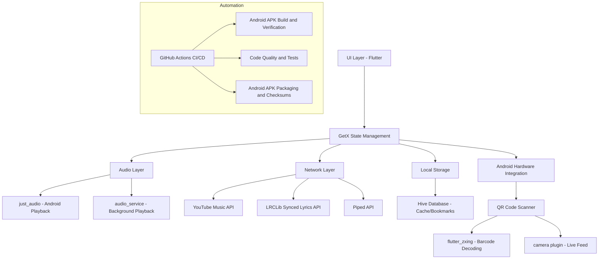

<div align="center">

# 🚀 **This repository is the continued version of MuziiNap.**
This app is a fork of the original [MuziiNap app by anandnet](https://github.com/anandnet/MDLovFi-Music), with additional features and improvements actively added and maintained by **Merrmist**.

</div>


# MuziiNap

An **Android-only** music streaming app built with Flutter. The app streams music from YouTube/YouTube Music without requiring login or showing advertisements.

# Features
* Ability to play songs from YouTube/YouTube Music.
* Song cache while playing
* Radio feature support
* Background music
* Playlist creation & bookmark support
* Artist & Album bookmark support
* Import song, Playlist, Album, and Artist via sharing from YouTube/YouTube Music
* Streaming quality control
* Song downloading support
* Language support
* Skip silence
* Dynamic Theme
* Flexible Bottom Navigation / Side Navigation preference
* Equalizer support
* Android Auto support
* Synced & Plain Lyrics support
* Sleep Timer
* No advertisements
* No login required
* Piped playlist integration
* QR Code Sharing & Scanning
* Hardware keyboard navigation where supported
* Double-tap to seek & dedicated +/- 10s buttons
* Live Lyrics translation

# Architecture


# Download
Download the Android APK from the [GitHub Releases page](https://github.com/squiraldot/CoreMuzii/releases/latest). Use the same distribution source for future updates so the app's signing identity remains consistent.

# Troubleshoot
* If notification controls do not work or playback stops due to system optimization, enable the ignore-battery-optimization option in settings where available.

# License
```
MuziiNap is a free software licensed under GPL v3.0 with following condition.

- Copied/Modified version of this software can not be used for 'non-free' and profit purposes.
- You can not publish copied/modified version of this app on closed source app repository
  like PlayStore/AppStore.
```

# Disclaimer
```
This project has been created while learning & learning is the main intention.
This project is not sponsored or affiliated with, funded, authorized, endorsed by any content provider.
Any Song, content, trademark used in this app are intellectual property of their respective owners.
MuziiNap music is not responsible for any infringement of copyright or other intellectual property rights that may result
from the use of the songs and other content available through this app.

This Software is released "as-is", without any warranty, responsibility or liability.
In no event shall the Author of this Software be liable for any special, consequential,
incidental or indirect damages whatsoever (including, without limitation, any
other pecuniary loss) arising out of the use of inability to use this product, even if
Author of this Sotware is aware of the possibility of such damages and known defect.
```

# Learning References & Credits
<a href='https://docs.flutter.dev/'>Flutter documentation</a> - a guide to Flutter app development<br/>
<a href='https://suragch.medium.com/'>Suragch</a>'s articles related to just_audio and state management<br/>
<a href='https://github.com/sigma67'>sigma67</a>'s unofficial YouTube Music API project<br/>
App UI inspired by <a href='https://github.com/vfsfitvnm'>vfsfitvnm</a>'s ViMusic<br/>
Synced lyrics provided by <a href='https://lrclib.net'>LRCLIB</a><br/>
<a href='https://piped.video'>Piped</a> for playlists.

#### Major Packages used
* just_audio - Android audio playback
* audio_service - background music and Android media controls
* get - state management, dependency injection, and route management
* youtube_explode_dart - third-party package for song URLs
* hive / hive_flutter - local database and caching
* flutter_zxing and camera - QR/barcode scanning
